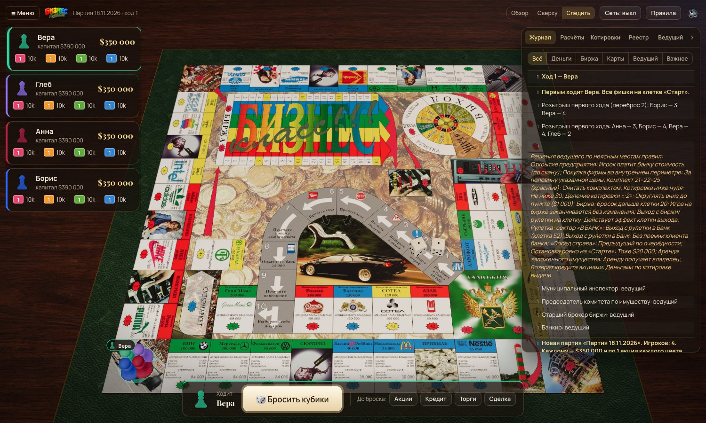

# «Бизнес-класс!!!»

Финансово-экономическая настольная игра в 3D — прямо в браузере.

**▶ Играть: https://deschenya.github.io/business-class/**

## Об игре

«Бизнес-класс!!!» — российская настольная игра 2001 года, «практическое пособие для всех, кто хочет
научиться современному бизнесу». Цель — разбогатеть больше других. Разорившийся игрок выбывает.

В одной игре объединены два поля и несколько игровых областей:

- **Бизнес за рубежом** — внешний периметр с фирмами: Puma, Nike, IBM, Тойота, Мерседес и другие.
  Покупайте участки, открывайте филиалы и, собрав три подряд одного цвета, — предприятия.
- **Бизнес в России** — внутренний, более рискованный периметр: АЗЛК, Балтика, Сбербанк, Аэрофлот…
  Въезд и выезд — через таможню, с пошлинами.
- **Биржа** — акции четырёх цветов, у каждого игрока свои котировки. В рискованном режиме биржевые карточки
  меняют курсы сразу у всех.
- **Рулетка**, **автострада**, **отель**, **банк**, **супермаркет**.
- Карточки **«Сюрприз»**, **«Извещение»**, **«Подарок»** и **«Штраф»**.

Есть роли ведущих: банкир, старший брокер биржи, председатель комитета по имуществу и муниципальный
инспектор. Кредиты под залог, открытые торги и сделки между игроками — как в настоящем бизнесе.
Момент окончания партии игроки выбирают сами.

Играть можно **на одном устройстве**, передавая ход по очереди, или **по сети**: хост создаёт
комнату, а друзья подключаются по ссылке. Партия сохраняется автоматически.

## Авторы оригинальной игры

| | |
|---|---|
| Автор (правообладатель) | **© Чернышев К.И., 2001** |
| Серия | развивающе-обучающие игры «Познай окружающий мир», г. Ростов-на-Дону |
| Сайт из буклета | www.lukomorye.narod.ru |
| Девиз на обложке | «Учись бизнесу сейчас, и тогда всё будет класс!» — В.Д. Дзюбин |

Данные взяты из выходных данных оригинального буклета правил.

Это некоммерческий фанатский проект. Права на игру, её правила, оформление поля и карточек
принадлежат правообладателям оригинала. Названия и логотипы фирм на поле принадлежат их владельцам.
Если вы правообладатель и хотите, чтобы материалы были убраны, создайте issue в этом репозитории.

## Лицензия

Код, 3D-модели и сгенерированный арт этого проекта переданы в общественное достояние по
[The Unlicense](LICENSE) — используйте как угодно.

Материалы оригинальной игры (поле, карточки, правила, сканы буклета) и логотипы фирм под эту
лицензию **не подпадают** (см. [NOTICE](NOTICE)): они принадлежат своим правообладателям и используются некоммерчески.

